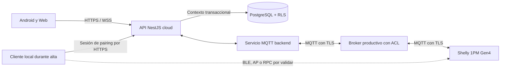

# Informe 01 de 03 · Auditoría y propuesta de backend y base de datos SmartHome

**Destinatario:** desarrollador de backend y base de datos.

**Corte funcional:** 12/10/2026. **Elaboración:** 14/10/2026, America/Bogota.

**Entrega prevista del equipo:** jueves 15/10/2026.

**Revisión:** incorpora los complementos del solicitante; 19 secciones, backlog BD-01 a BD-20 alineado a HU `09-dev`–`16-dev`, ramas y carriles backend/BD en paralelo, integración incremental y commits pequeños por avance verificable.
**Alcance autorizado:** inspección y propuesta. Este informe no autoriza implementación, migraciones, cambios de broker o Shelly, commits ni despliegues.

**Dictamen.** **DOCUMENTADO:** el material aportado describe una base local operativa. **PRUEBA DECLARADA:** se probó el ON/OFF del relé de un único Shelly físico; esta declaración no acredita pairing, consumo, aislamiento multiusuario ni operación cloud. **CÓDIGO LOCAL INSPECCIONADO:** existen controles concretos en la cadena JWT → NestJS → PrismaRlsService → PostgreSQL/RLS. La prioridad es completar pairing local seguro, identidad MQTT individual, conectividad cloud, conservación y consulta de históricos y pruebas multiusuario. **SIN VERIFICAR:** preparación de producción; sin decisiones y evidencias de cloud, dominio/certificados, broker productivo y POC de pairing, no hay sustento para certificar producción el jueves 15/10/2026.

Convención aplicable a todo el informe:

| Clasificación de evidencia | Qué acredita |
|---|---|
| CÓDIGO LOCAL INSPECCIONADO | Lectura estática de TypeScript, Prisma, SQL, configuración o pruebas. No acredita ejecución ni estado de una base instalada. |
| PRUEBA DECLARADA | Exclusivamente el ON/OFF físico indicado en el material; no fue repetido en esta auditoría. |
| REPOSITORIO REMOTO INSPECCIONADO | Requiere lectura remota efectiva. No se asigna a ningún hallazgo: los dos intentos de acceso web no recuperaron contenido. |
| DOCUMENTADO | Decisión o afirmación del material y documentación local. Las propuestas se identifican expresamente como tales; no son capacidades existentes. |
| SIN VERIFICAR | No hay evidencia suficiente, resultado actual o comprobación de ejecución. |

Las prioridades califican impacto o trabajo pendiente, no certeza: **P0**, seguridad crítica, pérdida de datos o bloqueo total; **P1**, flujo esencial o requisito de producción; **P2**, defecto funcional o de calidad relevante; **P3**, mejora. Un P0 de backlog no demuestra por sí mismo una vulnerabilidad. Los controles correctos se consignan como controles, sin asignarles una prioridad de defecto.

## 1. Inventario de backend observado

### 1.1. Baseline y límites de la evidencia

**CÓDIGO LOCAL INSPECCIONADO:** se inspeccionaron las copias locales cuyos orígenes Git declaran `nataliachala1/smarthome-backend` y `nataliachala1/smarthome-database`:

| Repositorio | Copia inspeccionada | Rama local observada | HEAD local | Fecha del último commit local |
|---|---|---|---|---|
| Backend | Raíz del workspace | `08-dev` | `8d6de00f11c3132ede93b91c0700485345f31b59` | 06/10/2026 |
| Base de datos | `smarthome-database/`, repositorio Git anidado | `03-dev` | `e18b2d02fc266a48cce57ff226dde335f0496658` | 08/10/2026 |

**SIN VERIFICAR:** correspondencia con el HEAD remoto y con lo desplegado o aplicado el 12/10. No se hizo fetch ni se sustituyeron copias. Al iniciar, el backend mostraba la carpeta anidada como no versionada; la copia de BD tenía `revision-dispositivos.txt` sin seguimiento. Ninguno se considera un resultado de pruebas de esta auditoría ni se modifica.

**DOCUMENTADO:** la jerarquía es decisiones de la responsable del 12/10 → alcance actualizado y plan maestro → implementación demostrada → SRS histórico. El adjunto es la fuente de las decisiones vigentes; el alcance local del 08/09 es anterior. No se proporcionaron como documentos íntegros separados el plan maestro, el alcance actualizado ni el SRS. Su contenido completo está **SIN VERIFICAR**. La documentación histórica de validación no se convierte en prueba actual.

### 1.2. Decisiones que gobiernan el componente

Todas las filas siguientes son **DOCUMENTADO**, tomadas del material del 12/10; su cumplimiento integral está **SIN VERIFICAR** salvo las comprobaciones estáticas indicadas después.

| Decisión vigente | Consecuencia para backend/BD y clientes |
|---|---|
| Plataforma multiusuario accesible por Internet | Backend y broker independientes del PC del usuario. |
| Un único Shelly físico | Repetir escenarios sobre ese equipo; usuarios y hogares de prueba no equivalen a más equipos reales. |
| Alta de equipo nuevo sin Wi-Fi y equipo ya conectado, sin app oficial Shelly | POC local BLE/AP/RPC; BLE no es capacidad demostrada. |
| Un ID de fabricante no pertenece a dos hogares a la vez | Exclusión concurrente; transferencia entre hogares fuera del MVP. |
| OWNER administra, configura y controla; MEMBER controla y consulta; GUEST consulta | Autorización por membresía del hogar; ACL funcional por dispositivo solo si se aprueba. |
| OWNER/MEMBER consultan energía, potencia, estadísticas e históricos de sus hogares; GUEST resumen básico | Separar autorización y datos devueltos; ocultar pantallas no basta. |
| Alertas marcables como leídas | No presentar «Resolver». Lectura y desaparición de la causa son estados independientes. |
| Notificaciones in-app y push Android | Sin pantalla de configuración personalizada; tokens push revocables. |
| Baja sin borrar históricos | No implica apagado físico; definir y probar revocación MQTT. |
| Control optimista con pendiente, confirmación/rechazo y timeout con reversión | Publicación MQTT no es confirmación física. |
| Clientes es/en/fr/pt; errores backend con códigos estables | Acordar catálogo de códigos y traducciones de cliente. |

No se incorporan zonas, tarifas, recomendaciones, notificación configurable, sincronización manual, modo offline completo, desactivación de hogares como flujo independiente, stratum, MFA ni alemán. **DOCUMENTADO: límite de alcance.**

### 1.3. Contratos locales Shelly

**CÓDIGO LOCAL INSPECCIONADO:** `ShellyController` declara la base `api/v1/homes/:homeId/shelly`, `JwtAuthGuard` en el controlador y `ParseUUIDPipe` en `homeId` de las tres operaciones [S1].

| Método y ruta existente | Entrada observada | Alcance |
|---|---|---|
| `GET /api/v1/homes/:homeId/shelly/discover` | UUID de hogar; sin body | Busca equipos alcanzables desde la red del backend. |
| `POST /api/v1/homes/:homeId/shelly/identify` | `{shellyIp}`; DTO exige IPv4 | Identificación local, compatibilidad y consulta MQTT cuando procede. |
| `POST /api/v1/homes/:homeId/shelly/provision` | `{shellyIp,name}`; nombre con trim y longitud 1–100 | Configura MQTT y después crea el dispositivo. |

**P1 · CÓDIGO LOCAL INSPECCIONADO / DOCUMENTADO:** estos contratos implementan un modo local; no constituyen pairing cloud completo [S1–S5]. No se inventa un endpoint de pairing existente. **SIN VERIFICAR:** respuestas HTTP reales en esta auditoría. El decorador Swagger de `identify` documenta 200, pero no basta para afirmar el código HTTP real sin revisar la configuración efectiva y ejecutar el contrato.

### 1.4. Referencias de inspección

Los identificadores siguientes permiten rastrear los hallazgos a archivos reales; los números son líneas de las copias inspeccionadas, no resultados de ejecución.

| Fuente | Archivo y localización |
|---|---|
| S1 | [ShellyController](../src/modules/devices/presentation/controllers/shelly.controller.ts), líneas 39–190; DTO [identify](../src/modules/devices/application/dto/identify-shelly-device.dto.ts), 4–12, y [provision](../src/modules/devices/application/dto/provision-shelly-device.dto.ts), 12–38. |
| S2 | [Discovery service](../src/modules/devices/infrastructure/shelly/shelly-discovery.service.ts), 31–197; [caso de uso discovery](../src/modules/devices/application/use-cases/discover-shelly-devices.use-case.ts), 27–160. |
| S3 | [Identificación](../src/modules/devices/application/use-cases/identify-shelly-device.use-case.ts), 18–88. |
| S4 | [Cliente RPC](../src/modules/devices/infrastructure/shelly/shelly-rpc-client.service.ts), 38–289. |
| S5 | [Provisionamiento](../src/modules/devices/application/use-cases/provision-shelly-device.use-case.ts), 43–210; [creación](../src/modules/devices/application/use-cases/create-device.use-case.ts), 19–43. |
| S6 | [Repositorio de dispositivos](../src/modules/devices/infrastructure/persistence/prisma-device.repository.ts), autorización 22–63, control 134–174, creación 177–199, baja 331–390, errores 447–454. |
| S7 | [PrismaRlsService](../src/infrastructure/database/prisma/prisma-rls.service.ts), 9–23; [guard JWT](../src/modules/auth/presentation/http/guards/jwt-auth.guard.ts), 43–104. |
| S8 | [Tablas devices](../smarthome-database/01_ddl/03_tables/003_create_devices_tables.sql), 17–47; [Prisma](../prisma/schema.prisma), 163–190. |
| S9 | [Helpers RLS 006](../smarthome-database/01_ddl/07_functions/006_rls_security_functions.sql), 52–150; [políticas devices](../smarthome-database/03_dcl/02_policies/002_rls_devices.sql), 29–196; [roles técnicos](../smarthome-database/03_dcl/00_roles/001_create_roles.sql), 39–77 y 131–138. |
| S10 | FK de [dispositivos](../smarthome-database/01_ddl/04_alter/003_add_alter_devices.sql), 1–17; [consumo](../smarthome-database/01_ddl/04_alter/004_add_alter_consumption.sql), 1–9; [notificaciones](../smarthome-database/01_ddl/04_alter/005_add_alter_notifications.sql), 1–20. |
| S11 | [Control](../src/modules/devices/application/use-cases/control-device.use-case.ts), 32–72; [publisher MQTT](../src/modules/devices/infrastructure/messaging/mqtt-device-control.publisher.ts), 28–104. |
| S12 | [Subscriber MQTT](../src/modules/devices/infrastructure/messaging/mqtt-device-status.subscriber.ts), actualización/ingesta 195–430, adaptación Shelly 634–711, delta 768–782. |
| S13 | [Gateway realtime](../src/modules/realtime/realtime.gateway.ts), 20–120; [eventos](../src/modules/realtime/realtime-events.service.ts). |
| S14 | [Listado de consumo por dispositivo](../src/modules/consumption/application/use-cases/list-device-consumption.use-case.ts), 23–103; [resumen por hogar](../src/modules/consumption/application/use-cases/get-home-consumption-summary.use-case.ts), 20–121; [RLS consumo](../smarthome-database/03_dcl/02_policies/003_rls_consumption.sql), 46–64 y 150–168. |
| S15 | [Notificaciones HTTP](../src/modules/notifications/presentation/controllers/notifications.controller.ts), 27–141; [actualización de estado](../src/modules/notifications/application/use-cases/update-notification-status.use-case.ts). |
| S16 | [Alcance 08/09](../ALCANCE_2026_09_08.md), 5–26 y 43–63; [prueba devices-scope](../test/devices-scope.e2e-spec.ts), 49–54, 115 y 180; [validación histórica BD](../smarthome-database/VALIDACION_FINAL.md), 3 y 39–54. |
| S17 | [README BD](../smarthome-database/README.md), 15–40; [operación y retención](../smarthome-database/OPERACION_Y_RETENCION.md), 3–23; [master Liquibase](../smarthome-database/changelog/changelog-master.yaml); [changesets alter](../smarthome-database/01_ddl/04_alter/changelog.yaml). |
| S18 | [Contrato MQTT documentado](MQTT_CONTRACT.md), 45–64, 264–289 y 380–417; [bootstrap NestJS](../src/main.ts), 13–48; [dependencias y scripts](../package.json), 8–49. |

### 1.5. Organización propuesta por HU y ramas paralelas de backend y BD

**DOCUMENTADO — organización indicada por el solicitante.** Las HU y nombres de rama siguientes ordenan el trabajo futuro del backend y su carril de BD en paralelo. Backend prepara contratos y comportamiento mientras BD prepara el incremento de esquema requerido por la misma HU; ambos se coordinan mediante compatibilidad y puertas de integración, sin esperar a completar toda la HU del otro repositorio. **SIN VERIFICAR:** existencia, contenido y estado de aceptación de esas ramas; no se inspeccionaron como si fueran las copias locales `08-dev` y `03-dev`. No se crean ramas ni se presupone que el repositorio de BD utilice los mismos nombres de rama.

| HU / rama backend indicada | Historia de usuario | Carril backend propuesto | Carril BD paralelo propuesto | Backlog |
|---|---|---|---|---|
| `09-dev` | production-config-and-hardening | Configuración segura, sesión Socket.IO y contratos base. | Comparar baseline, roles y camino incremental; preparar fixtures de permisos, sin DDL anticipado innecesario. | BD-01 transversal; BD-02/03/17. |
| `10-dev` | mqtt-cloud-tls-and-topic-namespace | Diseño cloud, TLS y contrato de namespace/tópicos; nombres definitivos pendientes de POC y acuerdo. | Revisar cómo se relacionan tópicos e identidad con el esquema existente; proponer DDL solo si el contrato lo requiere. | BD-06/07. |
| `11-dev` | device-mqtt-credentials-and-acl | Puerto/flujo de emisión, ACL, rotación y revocación individual, coordinado con broker. | Preparar changesets incrementales de identidad y relaciones, restricciones y revocación; sin secretos en claro. | BD-07/10/12. |
| `12-dev` | device-pairing-session-backend | OpenAPI, estados, posesión, idempotencia y reconciliación, sin dar por operativo el equipo. | Preparar changesets de sesión, token hasheado, expiración, FK y RLS contra el mismo contrato. | BD-08/09/10/11. |
| `13-dev` | shelly-cloud-validation-support | POC con el único equipo, validación RPC, confirmación de control y conectividad. | Revisar `last_seen_at` existente y persistencia/deduplicación; DDL adicional solo si la validación demuestra necesidad. | BD-08/13/16/19. |
| `14-dev` | health-observability-and-metrics | Salud, trazas sin secretos, métricas, alertas técnicas y procedimiento operativo. | Revisar consultas/índices de consumo en paralelo al diseño de métricas; changesets nuevos solo con evidencia y aprobación. | BD-20. |
| `15-dev` | ci-cd-and-staging-deployment | Preparar CI/CD, staging y smoke de API/correo/broker. | Preparar validación y aplicación del historial incremental, backup/restauración y comprobación de permisos; sin sustituirlo por un snapshot. | BD-18. |
| `16-dev` | production-readiness-fixes | Corregir roles, consumo, push, lectura de alertas y recuperación conforme a contratos. | Revisar RLS, históricos, integridad y consultas; preparar únicamente los changesets que cada corrección requiera. | BD-03/04/05/14/15/19. |

**P1 · DOCUMENTADO — trazabilidad propuesta:** cada avance identifica HU → BD-ID → contrato/cambio backend → changeset nuevo, si procede → pruebas/evidencias → commits de backend y BD compatibles. Una HU no obliga a crear una tabla ni un changeset vacío. La BD evoluciona incrementalmente en paralelo al backend, HU por HU y por avances verificables; no se propone terminar primero todo el backend ni aplicar una migración masiva previa de todas las HU. Los cambios compartidos tienen una HU responsable y se referencian desde las HU consumidoras, evitando changesets duplicados o contratos divergentes.

**DOCUMENTADO — dependencias:** el número de rama identifica una HU, no garantiza orden de ejecución ni independencia. Por ejemplo, BD-17 en `09-dev` depende de la matriz BD-04 de `16-dev`: acordar antes esa matriz y sus criterios, y esperar su evidencia para aceptar BD-17. BD-20 en `14-dev` puede diseñarse antes, pero su aceptación depende del staging BD-18 de `15-dev`. No marcar una HU terminada con dependencias pendientes. Política de commits y aprobación: sección 15.

## 2. Descubrimiento e identificación

**Control · CÓDIGO LOCAL INSPECCIONADO:** Bonjour/mDNS busca servicios Shelly con ventana predeterminada de 10 s y `browser.update()` cada 1,5 s. El bloque `finally` limpia el intervalo, detiene el browser y destruye Bonjour [S2]. Es limpieza estática del flujo inspeccionado, no una prueba de ausencia de fugas bajo cualquier fallo.

**Control · CÓDIGO LOCAL INSPECCIONADO:** el caso de uso comprueba `homes.fn_can_manage_home` bajo `withUserContext` antes del descubrimiento. Después inspecciona candidatos por HTTP, admite solo `S4SW-001P16EU` y generación 4 y deduplica por `manufacturerDeviceId`. Identificar directamente aplica la misma autorización y filtro [S2, S3, S9].

**P2 · CÓDIGO LOCAL INSPECCIONADO — límite temporal:** los 10 s no son un timeout total HTTP: después se ejecuta la inspección de candidatos mediante `Promise.all`. La solicitud puede superar ese tiempo; no se dispone de medición real. **DOCUMENTADO — propuesta:** acordar con clientes un presupuesto total y límites de candidatos/concurrencia para diagnóstico [S2, S4].

**Control · CÓDIGO LOCAL INSPECCIONADO:** el cliente RPC acepta IPv4 de `10/8`, `172.16/12` y `192.168/16`; por esa lista rechaza loopback/localhost y direcciones públicas. `fetch` usa `redirect: 'error'`, `AbortController` y timeout de 3 s por llamada. La respuesta de identificación tiene comprobación estructural mínima antes de utilizarse [S4].

**P2 · CÓDIGO LOCAL INSPECCIONADO — riesgo residual:** una IP privada puede pertenecer a otro segmento alcanzable por el backend; la validación no demuestra pertenencia a la red física del hogar. **SIN VERIFICAR:** acceso indebido efectivo o SSRF explotable. **DOCUMENTADO — propuesta:** restringir segmentos y salida de red en la herramienta local protegida, según el entorno aprobado; no exponer discovery como solución de alta cloud.

## 3. Aprovisionamiento local

**CÓDIGO LOCAL INSPECCIONADO:** el orden de [S5] es:

1. Reidentificar y verificar permisos OWNER mediante `fn_can_manage_home`.
2. Rechazar `authenticationRequired=true`.
3. Leer configuración global de broker y credenciales MQTT del backend; validar presencia de broker y coherencia usuario/contraseña.
4. Ejecutar `MQTT.SetConfig` con `topicPrefix=manufacturerDeviceId`.
5. Solicitar reinicio si `restartRequired` es verdadero.
6. Esperar conexión MQTT: hasta 12 consultas, con esperas y timeout individual de RPC [S4]. No son 12 s ni un plazo total garantizado.
7. Solo entonces invocar `CreateDeviceUseCase` y devolver el resultado.

| Hallazgo | Prioridad y evidencia | Evaluación y propuesta |
|---|---|---|
| Efecto físico previo al registro | **P1 · CÓDIGO LOCAL INSPECCIONADO**; incidencia real **SIN VERIFICAR** | Una colisión de ID/nombre o un error BD posterior puede dejar el Shelly reconfigurado sin alta. Prevalidar autorización, unicidad y configuración; reservar la operación y mantener control transaccional de concurrencia. Añadir idempotencia, trazabilidad y reconciliación. La prevalidación sola no evita carreras. No prometer rollback físico automático. |
| Alcance de red incompatible con alta desde API pública | **P1 · CÓDIGO LOCAL INSPECCIONADO / DOCUMENTADO** | El flujo presupone que NestJS alcanza la LAN. Una API cloud no descubre por mDNS ni alcanza por sí sola las IP privadas del hogar. Llevar el contacto inicial al cliente local; conservar discovery como diagnóstico protegido. Conectividad cloud desplegada **SIN VERIFICAR**. |
| Identidad MQTT compartida | **P1 · CÓDIGO LOCAL INSPECCIONADO** | El aprovisionamiento usa credenciales globales, no emite una identidad por equipo. Estas credenciales no proporcionan aislamiento individual por sí mismas. ACL efectivas y configuración de broker **SIN VERIFICAR**. Diseñar identidad individual, permisos mínimos, rotación y revocación. |
| Respuesta RPC sin esquema de resultado | **P2 · CÓDIGO LOCAL INSPECCIONADO** | `postRpc<T>()` parsea JSON mediante cast y devuelve `null as T` para cuerpo vacío o `null`; `configureMqtt()` accede a `result.restart_required`. Hay una ruta potencial de fallo por nulo y aceptación de formas inesperadas. Validar por método; aceptar nulo en un método que lo permita no implica aceptarlo para `MQTT.SetConfig`. Fallo ejecutado **SIN VERIFICAR**. |
| Diagnóstico MQTT insuficiente | **P2 · CÓDIGO LOCAL INSPECCIONADO** | `getMqttConnected()` devuelve `null` ante excepciones o forma inválida; pierde la distinción entre autenticación, timeout y respuesta inválida. Conservar una causa interna saneada, sin registrar credenciales; pactar códigos de error estables. |

Todas las medidas de la última columna son **DOCUMENTADO — propuestas**, sin implementación ni pruebas realizadas en esta auditoría.

## 4. Persistencia y autorización

### 4.1. Controles concretos observados

**CÓDIGO LOCAL INSPECCIONADO:** `JwtAuthGuard` verifica el token, exige `sub`, `role` y `sv`, consulta al usuario, exige cuenta activa y compara `sessionVersion` [S7]. El rol global del JWT no sustituye el rol de hogar.

**CÓDIGO LOCAL INSPECCIONADO:** `PrismaRlsService.withUserContext` abre una transacción, ejecuta `set_config('app.current_user_id', userId, true)` y pasa el mismo cliente transaccional a la operación. `true` limita el contexto a la transacción. `PrismaDeviceRepository.create` comprueba `fn_can_manage_home` dentro de ese contexto antes de insertar [S6, S7].

**CÓDIGO LOCAL INSPECCIONADO:** las funciones 006 consultan membresías y usuarios activos; `fn_can_manage_home` exige OWNER y hogar operativo. Las políticas SQL habilitan RLS sobre dispositivos y separan aplicación e ingesta; los roles funcionales se declaran `NOBYPASSRLS`. Existe un rol administrativo con `BYPASSRLS` expresamente excluido del uso normal del backend [S9]. **SIN VERIFICAR:** rol LOGIN efectivo, privilegios heredados, propietario de tablas y políticas instaladas en la conexión real. La declaración de un rol seguro no demuestra que NestJS lo utilice.

**CÓDIGO LOCAL INSPECCIONADO:** `findForControl` usa autorización OWNER o MEMBER activo de hogar operativo y excluye GUEST; exige dispositivo `ACTIVE` y sin `deleted_at`. La rama OWNER de `authorizeControl` utiliza `fn_is_home_owner`, sin exigir por sí misma `fn_is_home_active`; no debe describirse como una condición idéntica para ambos roles [S6]. **DOCUMENTADO:** se corrige cualquier lectura histórica de «solo OWNER controla»; no se presenta ese plan histórico como archivo inspeccionado.

**CÓDIGO LOCAL INSPECCIONADO:** `translateError` traduce P2002 a conflicto, P2003 a referencia inválida y P2025 a acceso denegado; el auxiliar reconoce el código PostgreSQL 42501 [S6]. Esta traducción no acredita todavía un catálogo completo de códigos de negocio estable para cuatro idiomas.

### 4.2. Unicidad, baja e históricos

**CÓDIGO LOCAL INSPECCIONADO:** `delete` hace un `update` con `deleted_at`, `DEACTIVATED`, `OFFLINE` e `is_on=false`; ese método no borra consumos, alertas ni auditoría [S6]. El caso de uso de baja llama al repositorio; no se observa allí publicación de apagado ni revocación MQTT. Esos valores BD no prueban que el relé se haya apagado.

**CÓDIGO LOCAL INSPECCIONADO:** `uq_device_manufacturer_id` es una restricción `UNIQUE(manufacturer_device_id)` a nivel de tabla; Prisma la refleja sin condición sobre `deleted_at` [S8]. No apareció una sustitución de esa restricción en los SQL revisados. Por lo tanto, el esquema fuente impediría reinsertar un mismo ID no nulo aunque el registro esté eliminado lógicamente. **SIN VERIFICAR:** definición y alcance del índice realmente instalado. No confundirlo con `uq_device_name`, cuyo changeset sí crea un índice parcial por `deleted_at IS NULL`.

**CÓDIGO LOCAL INSPECCIONADO:** sí existen FK de consumo, alertas y notificaciones, incluidas referencias compuestas dispositivo/hogar, y las FK revisadas no declaran cascada de borrado [S10]. Prisma muestra `NoAction`. Por tanto, no corresponde afirmar que «no hay FK». **P1 · SIN VERIFICAR:** cobertura de integridad y retención efectivas en la base instalada, operaciones administrativas y recuperación. El documento de retención contiene pautas de telemetría y auditoría, pero no prueba su ejecución [S17].

**P1 · CÓDIGO LOCAL INSPECCIONADO — consulta de históricos tras la baja:** `ListDeviceConsumptionUseCase` exige dispositivo activo y `deleted_at=null` antes de leer consumo; después de la baja lógica, ese flujo devuelve «Dispositivo no encontrado» según su lógica [S14]. Esto demuestra una restricción estática de consulta, no borrado de datos ni fallo ejecutado. **DOCUMENTADO — propuesta:** conservar el registro y permitir consulta histórica autorizada a OWNER/MEMBER conforme a la pertenencia al hogar, sin reactivar el equipo. Verificar también listados, agregados y alertas. BD-05/BD-12.

### 4.3. Evidencia de pruebas y brecha multiusuario

**DOCUMENTADO:** el alcance del 08/09 declara 14 pruebas HTTP y uso de `smarthome_app`; también declara sustitución de autenticación [S16]. Esa cifra no se adopta como resultado actual. **CÓDIGO LOCAL INSPECCIONADO:** existe una suite condicionada a una URL de prueba, con `describe.skip` si no está disponible, configuración de rol y sustitución de `JwtAuthGuard`. Su existencia no prueba que pase contra este baseline ni valida JWT real.

**P1 · SIN VERIFICAR:** falta evidencia E2E actual de la cadena completa con JWT real, rol de conexión sin BYPASSRLS ni privilegios de propietario que eludan RLS, y usuarios de hogares distintos. Debe incluir contexto alternado en conexiones reutilizadas del pool, invitación pendiente, membresía revocada, dispositivo de otro hogar y accesos negativos HTTP/Socket.IO. Una suite con guard sustituido es evidencia parcial, no certificación multiusuario. BD-03/BD-04.

## 5. Otros módulos

**DOCUMENTADO:** el material incluye Auth/JWT/refresh/logout, Users, Homes/Invitations, Consumption, Notifications y Socket.IO `/realtime`. **CÓDIGO LOCAL INSPECCIONADO:** se localizaron sus controladores y se inspeccionaron puntos concretos de autorización, consumo, notificaciones y gateway. No se reejecutó ninguno.

| Componente | Evidencia y alcance observado | Pendiente |
|---|---|---|
| Auth | **CÓDIGO LOCAL INSPECCIONADO:** rutas login, refresh, logout y logout-all; guard con cuenta activa y versión de sesión. | **P1 · SIN VERIFICAR:** rotación/reutilización de refresh, revocación efectiva y contrato de sesión Android. La cookie web no demuestra integración móvil. |
| Users | **CÓDIGO LOCAL INSPECCIONADO:** controlador de perfil y preferencias. | **P1 · SIN VERIFICAR:** cumplimiento es/en/fr/pt en clientes y catálogo backend de errores; preferencias existentes no autorizan configuración personalizada de notificaciones. |
| Homes/Invitations | **CÓDIGO LOCAL INSPECCIONADO:** membresías e invitaciones en controladores y helpers RLS. | **P1 · SIN VERIFICAR:** matriz completa y revocación entre API, consumo y realtime. |
| Consumption | **CÓDIGO LOCAL INSPECCIONADO:** rutas de listado, resumen y diario por hogar/dispositivo; adaptación Shelly convierte Wh a kWh dividiendo entre 1000 [S12, S14]. | **P1:** revisar GUEST e históricos indicados abajo; validar rangos, unidades y consistencia de agregados con lecturas conocidas. |
| Notifications | **CÓDIGO LOCAL INSPECCIONADO:** `read`, `read-all` y `dismiss`; estados `READ` y `DISMISSED` [S15]. | **P1 · SIN VERIFICAR:** ciclo de alerta y push Android. `DISMISSED` no equivale a causa desaparecida; no se introduce «Resolver». |
| Socket.IO | **CÓDIGO LOCAL INSPECCIONADO:** namespace `/realtime`, verificación JWT al conectar y sala por usuario [S13]. | **P1 · SIN VERIFICAR:** corte de sockets por logout, expiración o revocación de membresía; revalidación durante conexión y aislamiento de destinatarios. |

**P1 · CÓDIGO LOCAL INSPECCIONADO — granularidad GUEST:** el listado de lecturas por dispositivo admite `MEMBER` y `GUEST` en su comprobación de hogar y devuelve lecturas detalladas; las políticas de consumo revisadas también permiten SELECT a GUEST [S14]. Esto no se ajusta a limitar GUEST a resumen básico. **SIN VERIFICAR:** exposición HTTP efectiva en la instalación. **DOCUMENTADO — propuesta:** definir el resumen básico exacto y restringir consultas detalladas en API/BD, sin reducir la consulta completa de OWNER/MEMBER. BD-04/BD-05.

Riesgos que requieren comprobación antes de calificarlos como defectos de despliegue:

| Riesgo pendiente | Prioridad de revisión y evidencia | Cierre necesario |
|---|---|---|
| SMTP/Compose | **P2 · SIN VERIFICAR** | Coherencia entre proveedor de correo, variables y servicios del despliegue; entrega real de activación/recuperación en entorno autorizado. No se afirma que SMTP esté roto. |
| Secreto JWT de ejemplo en producción | **P0 · SIN VERIFICAR**, condicional | Verificar que producción usa secreto propio y gestión segura, sin mostrar ni solicitar su valor. El uso de `getOrThrow` comprueba presencia, no calidad ni procedencia. No se afirma exposición real. |
| Revocación de sockets | **P1 · CÓDIGO LOCAL INSPECCIONADO / SIN VERIFICAR** | El gateway leído comprueba JWT al conectar, sin consulta de `sessionVersion` en ese método. Reproducir logout/revocación/expiración y verificar cese de eventos; no extrapolar la protección HTTP. |
| Rate limiting | **P1 · CÓDIGO LOCAL INSPECCIONADO / SIN VERIFICAR** | Existe dependencia `@nestjs/throttler`; no se localizaron `ThrottlerGuard`, `ThrottlerModule` ni decoradores de límite en `src`. Verificar límites en aplicación y perímetro; la dependencia no prueba protección ni su ausencia global en infraestructura. |

## 6. Arquitectura objetivo

**DOCUMENTADO — propuesta sujeta a decisiones de infraestructura; despliegue SIN VERIFICAR.** Flujo conceptual solicitado: Android/Web → HTTPS/WSS → API NestJS cloud → PostgreSQL + RLS → servicio MQTT backend → broker MQTT con TLS/ACL → Shelly 1PM Gen4. PostgreSQL es persistencia y autorización; no actúa como intermediario de transporte MQTT.

**P1 · DOCUMENTADO — propuesta:** la excepción local existe durante el alta: el cliente alcanza el equipo y lo incorpora a Wi-Fi/broker según el protocolo que permita el firmware probado. La contraseña Wi-Fi nunca se envía ni persiste en el servidor central, incluidos logs y auditoría. BLE sigue siendo POC; AP temporal o RPC local son alternativas permitidas, no capacidades certificadas.

**P0 · DOCUMENTADO — requisito objetivo:** broker sin acceso anónimo, TLS validado, identidad individual y ACL de tópicos. Separar credencial técnica del backend de las identidades de dispositivos; negar publicación y suscripción cruzadas. Estas ACL de broker son distintas de una ACL funcional por dispositivo, que no forma parte de la autorización de producto aprobada. **SIN VERIFICAR:** proveedor, dominio, certificados, soporte efectivo del firmware y despliegue. No se selecciona proveedor ni se modifica el broker.

## 7. Contrato de pairing propuesto, no existente · HU 12-dev

**DOCUMENTADO — propuesta de HU `12-dev` (device-pairing-session-backend).** Agregado conceptual `DevicePairingSession`; nombres de operaciones, rutas y campos definitivos se acuerdan con móvil antes de implementar. El bootstrap y la revocación se coordinan con la identidad de HU `11-dev`; la prueba física y conectividad, con HU `13-dev`. La búsqueda en `src`, Prisma y DDL no encontró ese agregado. **SIN VERIFICAR:** cualquier implementación externa no aportada. No se asignan URLs nuevas como si existieran.

| Operación conceptual propuesta | Condición y resultado esperado |
|---|---|
| Iniciar | OWNER autorizado crea sesión limitada a usuario/hogar, con expiración e identificador de operación idempotente. |
| Declarar dispositivo identificado | Aporta identidad y evidencia local acordada; el backend valida compatibilidad, vigencia, permisos y exclusividad. El ID por sí solo no acredita posesión física. |
| Solicitar bootstrap MQTT | Genera identidad individual limitada a la sesión/equipo, con entrega y almacenamiento seguros; nunca devuelve credencial global del backend. |
| Confirmar | Exige conexión autenticada del equipo y asociación BD consistente; no acepta únicamente la afirmación del cliente. |
| Consultar / cancelar | Consulta estado autorizado; cancelación y expiración invalidan capacidades temporales y programan reconciliación si hubo efectos externos. |
| Revocar / vincular de nuevo | Revoca identidad anterior y aplica la regla de reasociación aprobada, conservando registros. No habilita transferencia entre hogares en el MVP. |

**DOCUMENTADO — estados propuestos:**

`PENDING → DEVICE_IDENTIFIED → BROKER_CONFIGURED → CONNECTED → COMPLETED`

Salidas: `EXPIRED`, `CANCELLED` y `FAILED`. Cada transición requiere precondiciones, versión/orden, auditoría y respuesta idempotente. `BROKER_CONFIGURED` no implica conexión; `CONNECTED` exige evidencia autenticada del broker; `COMPLETED` exige vinculación durable y autorizada. La UI solo muestra éxito con `COMPLETED` respaldado. Los nombres describen la propuesta, no un enum existente.

**P1 · DOCUMENTADO — requisitos de aceptación propuestos:** reintentos con la misma clave no crean dispositivos ni credenciales duplicados; peticiones concurrentes de hogares distintos no obtienen el mismo equipo; una sesión expirada o cancelada no completa por mensajes tardíos. Revalidar OWNER y membresía antes de completar, no solo al iniciar. Registrar pasos parciales, compensar mediante revocación cuando proceda y reconciliar broker/BD sin prometer reversión automática del equipo.

**P1 · SIN VERIFICAR:** mecanismo que prueba posesión física, bootstrap permitido por firmware y resolución segura del caso de un dispositivo previamente configurado. Debe definirse y demostrarse en BD-08 antes de cerrar el contrato; `manufacturerDeviceId` es identidad declarada, no prueba de propiedad.

## 8. Cambios DB sugeridos, sujetos a aprobación, por HU y en paralelo con backend

Todas las medidas siguientes son **DOCUMENTADO — propuestas**. No se crean tablas ni changesets en esta auditoría; los nombres físicos definitivos están pendientes. **SIN VERIFICAR:** su aplicación y funcionamiento.

| Área | HU asociada | Evidencia existente | Propuesta y prioridad |
|---|---|---|---|
| Sesión de pairing | `12-dev` | No se encontró `DevicePairingSession` en las fuentes buscadas. | **P1:** tabla de sesiones con usuario/hogar, identificador de fabricante cuando se conozca, hash de token, expiración, estado, control de concurrencia e idempotencia; FK, RLS y auditoría de transiciones. No almacenar el token en claro. |
| Identidad MQTT | `11-dev` | Aprovisionamiento con credenciales globales [S5]. | **P1:** identidad individual y estado de revocación asociados a dispositivo/sesión. Sin contraseñas en claro. Si el broker valida hashes, almacenar verificadores; si una integración exige recuperar un secreto, diseñar custodia cifrada o gestor de secretos y permisos mínimos. No confundir hashing con entrega recuperable. |
| Conectividad | `13-dev` | `last_seen_at` ya existe en SQL y Prisma, y el subscriber la actualiza [S8, S12]. | **P2:** reutilizar y validar esa columna antes de proponer otra. Tabla de eventos de conectividad solo si se aprueba necesidad histórica, retención y coste. |
| Reasociación | `11-dev`, coordinada con `12-dev` | Unicidad global del ID no nulo incluso después de baja lógica [S8]. | **P1:** pactar reactivación/revinculación del registro y revocación previa; no borrar para reinsertar. No cambiar sin más a índice parcial: podría perderse trazabilidad o facilitar reasignaciones no autorizadas. Transferencia entre hogares excluida. |
| Históricos, alertas y auditoría | `16-dev`; revocación relacionada en `11-dev` | Baja lógica, FK sin cascada en lo leído, consumo/alertas existentes y guía de retención [S6, S10, S17]. | **P1:** conservar identidad y contexto del hogar, permitir consulta histórica autorizada y excluir purga de históricos de negocio de la baja. Definir archivo/retención técnica sin confundir telemetría diagnóstica con históricos; comprobar backups y restauración autorizada. |
| Permisos de consumo | `16-dev` | API y RLS permiten lecturas detalladas a GUEST [S14]. | **P1:** restringir detalle a OWNER/MEMBER y definir resumen básico para GUEST, con cobertura en API y BD. |
| Lectura de alertas | `16-dev` | Notificación admite `READ` y `DISMISSED` [S15]. | **P1:** revisar primero el esquema de alertas; representar lectura por destinatario separadamente del estado de la causa. No duplicar tablas existentes sin justificarlo ni agregar «Resolver». |

**P0 · DOCUMENTADO — condición de conservación:** congelar y comparar baseline, changelogs e historial efectivamente aplicado antes de cualquier cambio. El último commit local de BD declara sustitución por un snapshot, y los documentos locales mezclan instrucciones de baseline limpio con referencias a historia incremental anterior. Esto no demuestra corrupción; **SIN VERIFICAR:** compatibilidad de actualización desde una instalación existente. No ejecutar instrucciones de reinicio o limpieza de volúmenes como parte de esta auditoría.

**P1 · DOCUMENTADO — regla de entrega futura:** usar únicamente changesets Liquibase nuevos, con precondiciones y rollback revisado; nunca editar migraciones ya aplicadas ni usar `prisma db push`. Diseñar y probar en entorno autorizado tanto instalación limpia como actualización incremental. El rollback debe respetar datos de negocio; una reversión que elimine datos de pairing/identidad exige estrategia de conservación, no solo SQL inverso. Cada changeset debe identificar la HU que lo requiere, su BD-ID, dependencias, rollback y commits compatibles del backend/BD. Validar el incremento junto al avance de backend correspondiente y preservar los changesets aplicados. BD-03/BD-10 no quedan autorizados por este informe.

### 8.1. Coordinación e integración incremental entre ambos repositorios

**P1 · DOCUMENTADO — propuesta de trabajo paralelo, no ejecución.** Cada incremento mantiene dos carriles sobre una línea base identificada. Las ramas de BD se acuerdan en su repositorio y se vinculan a la HU de backend; no se inventan sus nombres ni se confunde la rama local `03-dev` con una rama nueva ya creada.

| Punto de coordinación | Backend puede preparar en paralelo | BD puede preparar en paralelo | Puerta de integración y evidencia futura |
|---|---|---|---|
| Contrato mínimo de la HU | Operaciones, datos, errores estables y comportamiento autorizado. | Modelo existente, restricciones, RLS y necesidad real de esquema. | Acordar tipos, nulabilidad, unicidad, estados, permisos y criterios de prueba. Cambiar el acuerdo requiere actualizar ambos carriles. |
| Avance verificable independiente | Interfaces y lógica acotadas con pruebas aisladas donde proceda; simulaciones identificadas como tales. | Changeset nuevo y rollback revisable, dependencias e historial esperado; fixtures y validaciones en entorno autorizado. | Revisión de ambos artefactos sin esperar al cierre total de una HU. Una simulación no acredita integración BD, broker o equipo físico. |
| Integración del incremento | Adaptación de repositorio/Prisma al esquema pactado, con commit compatible identificado. | Incremento compatible con la versión aún activa del backend cuando sea viable; sin eliminar históricos ni modificar changesets aplicados. | Registrar commits compatibles, changesets en orden y precondiciones; ejecutar pruebas de integración solo si se autoriza. No activar código que necesite un esquema todavía ausente. |
| Aceptación y recuperación | Flujos autorizados y errores correctos; evidencia de aceptación de la HU. | Esquema, RLS, datos conservados y camino de recuperación revisados. | Validar instalación limpia e incremental y recuperación apropiada al cambio. Si un incremento no puede ser compatible, documentar la dependencia y coordinar su aplicación; no prometer integración sin bloqueo demostrado. |

**DOCUMENTADO — disciplina de ramas:** acordar una base común por incremento, revisar archivos compartidos y ordenar dependencias entre changesets. Integrar avances pequeños con la aprobación aplicable, contrastando el esquema y el cliente Prisma con los commits previstos. Una rama puede preparar trabajo independiente mientras otra espera evidencia, pero no se acepta ni despliega una combinación incompatible.

**DOCUMENTADO — capacidad del equipo:** hay una persona para backend+BD. Dos carriles mantienen artefactos y ramas coordinados y permiten avances alternados; no equivalen a dos personas adicionales ni convierten la cadena crítica en tareas independientes. La coexistencia real de versiones y la integración sin regresiones permanecen **SIN VERIFICAR** hasta sus pruebas autorizadas.

## 9. Contratos entre áreas

La columna «necesidad» contiene **DOCUMENTADO — contrato propuesto o decisión vigente**, no un contrato ya implementado. Las evidencias actuales son estáticas; toda aceptación de ejecución permanece **SIN VERIFICAR**.

| Área | HU responsable de la propuesta | Fuente de verdad actual y evidencia | Necesidad para web/móvil y aceptación | Prioridad |
|---|---|---|---|---|
| Sesión | `09-dev` | Backend de auth y guard; rutas refresh/logout localizadas. **CÓDIGO LOCAL INSPECCIONADO**. | Acordar almacenamiento/renovación por plataforma y cierre de sesión; no asumir que la cookie web resuelve Android. Probar expiración, logout-all y cese de realtime. | P1 |
| Roles por hogar | `16-dev` | Membresía activa y helpers RLS [S6, S9]. **CÓDIGO LOCAL INSPECCIONADO**. | Obtener rol efectivo del hogar mediante contrato acordado; nunca inferirlo de `createdBy` ni del rol global JWT. OWNER administra; MEMBER controla/consulta; GUEST solo consulta básica. | P1 |
| Estado | `13-dev`; transporte `10-dev` | BD actualizada por MQTT y evento `device.status.updated` [S12, S18]. **CÓDIGO LOCAL INSPECCIONADO / DOCUMENTADO**. | Separar estado de ciclo de vida, conectividad y `isOn`. Filtrar por hogar/dispositivo autorizado; tras reconectar consultar estado vigente y evitar que eventos tardíos sustituyan estado más reciente. | P1 |
| Control | `13-dev` | `PATCH /api/v1/homes/:homeId/devices/:deviceId/control`; respuesta `COMMAND_PUBLISHED` y `previousIsOn` [S11 y controlador devices]. **CÓDIGO LOCAL INSPECCIONADO**. | UI optimista «pendiente»; confirmar por evidencia física posterior, o rechazar/expirar y revertir. Acordar correlación, orden y timeout; un evento de estado o ACK de publicación por sí solo no acredita causalidad del comando. | P1 |
| Consumo | `16-dev` | Controladores de hogar/dispositivo y consultas [S14]. **CÓDIGO LOCAL INSPECCIONADO**. | Pactar `from/to` efectivos, límites inclusivos, zona/periodo, paginación y ausencia de datos. Resumen leído usa `gte/lte` y devuelve límites recibidos o `null`, no demuestra un rango efectivo calculado. W es potencia; Wh/kWh es energía. No sumar contadores acumulados ni llamar consumo a la media de potencia. Verificar reinicios, duplicados y orden de telemetría. | P1 |
| Alertas y lectura | `16-dev` | `PATCH /api/v1/notifications/:notificationId/read`, `read-all`; `READ` no cambia por definición la causa [S15]. **CÓDIGO LOCAL INSPECCIONADO / DOCUMENTADO**. | Mostrar lectura real por usuario; causa activa/desaparecida por separado. No presentar `resolve`; no interpretar `dismiss` como resolución. Verificar conteo no leído y eventos tras commit. | P1 |
| Push Android | `16-dev` | Requisito del 12/10 **DOCUMENTADO**; búsqueda no encontró integración push en `src`/Prisma/DDL revisados. | Contrato de registro, renovación y revocación de tokens ligado a usuario/instalación; permiso Android, cambio de cuenta y logout sin entrega al usuario anterior. No inventar endpoints ni afirmar push operativo. Integración **SIN VERIFICAR**. | P1 |
| Pairing | `12-dev`; identidad `11-dev` | Propuesta de sección 7 **DOCUMENTADO**; capacidad actual **SIN VERIFICAR**. | Contrato OpenAPI conjunto después del POC; UI sin éxito hasta `COMPLETED`; expiración, cancelación, conflicto, reintento y reconciliación visibles. Wi-Fi secreto solo en interacción local. | P1 |
| Idiomas y errores | `16-dev`; pairing `12-dev` y RPC `13-dev` | Decisión es/en/fr/pt **DOCUMENTADO**; traductor de errores HTTP inspeccionado. | Códigos estables pactados para auth, permisos, conflicto, offline, RPC y pairing; traducción en clientes. No usar el texto español de una excepción como identificador. Cobertura de los cuatro idiomas **SIN VERIFICAR**. | P1 |

**CÓDIGO LOCAL INSPECCIONADO:** el publisher ya distingue IDs Shelly y genera `Switch.Set` sobre su tópico RPC nativo; el subscriber tiene adaptación de tópicos/estado Shelly [S11, S12]. **DOCUMENTADO:** el contrato MQTT escrito advierte que el protocolo físico requiere adaptación [S18]. La implementación posterior prevalece para describir existencia del adaptador. **SIN VERIFICAR:** confirmación correlacionada, cobertura del adaptador y compatibilidad del firmware concreto en cloud. La única prueba física declarada sigue siendo ON/OFF.

## 10. Backlog BD-01 a BD-20, alineado a HU y ramas paralelas

**DOCUMENTADO — propuesta de trabajo posterior, no autorización de ejecución.** Las prioridades son las solicitadas; «aceptación» indica evidencia futura exigida, todavía **SIN VERIFICAR**. Tamaño relativo: **S < M < L**; no representa horas ni compromiso para el jueves. El diagnóstico de base de cada fila conserva la clasificación indicada. La HU asociada vincula los dos carriles de sección 1.5; artefactos backend y BD se preparan en paralelo conforme a sección 8.1. Las dependencias son condiciones de integración/aceptación: el diseño independiente puede adelantarse cuando no requiera un contrato o decisión aún ausentes, sin eludir seguridad, aprobación ni pruebas.

| ID | Prioridad / tamaño | HU asociada | Actividad y base de evidencia | Artefactos propuestos | Evidencia de aceptación futura | Dependencia |
|---|---|---|---|---|---|---|
| BD-01 | P0 / S | Transversal; inicio `09-dev` | Congelar baseline. **CÓDIGO LOCAL INSPECCIONADO:** HEAD locales y documentación de distintas etapas. | Manifiesto de commits, fuentes, lockfile, changelogs y estado aplicado; lista de diferencias sin secretos. | Backend/BD compatibles e identificados; diferencias de snapshot/historial explicadas, sin reescribir historia. | Acceso de lectura al estado aplicado y responsable que valide baseline. |
| BD-02 | P0 / M | `09-dev` | Auditar seguridad de despliegue. Defectos reales **SIN VERIFICAR**. | Matriz de variables por nombre, roles, exposición, CORS, cookies, correo, rate limiting y revocación; evidencias saneadas. | Conexiones sin privilegios indebidos, secreto propio gestionado sin mostrarlo, límites efectivos y pruebas negativas documentadas. | BD-01; configuración de entorno objetivo. |
| BD-03 | P1 / L | `09-dev`, `16-dev` | Validar migración limpia e incremental con rol sin BYPASSRLS, **solo si se autoriza**. Ejecución actual **SIN VERIFICAR**. | Plan de prueba aislada, historial/checksums, SQL revisado, rollback y contraste Prisma/SQL. | Evidencias de ambos caminos, permisos efectivos, prueba RLS negativa, rollback controlado sin pérdida de datos conservables. No contar suites omitidas como aprobadas. | BD-01/02; autorización expresa para ejecutar migraciones y pruebas con escritura. |
| BD-04 | P1 / M | `16-dev` | Matriz OWNER/MEMBER/GUEST y hogares ajenos. **CÓDIGO LOCAL INSPECCIONADO:** controles y brecha GUEST. | Matriz API/BD/realtime y pruebas positivas/negativas con JWT real. | OWNER administra/controla; MEMBER controla y consulta detalle; GUEST solo resumen y sin control. Pendiente/revocado/ajeno denegados; pool y sockets aislados. | BD-01/03; resumen GUEST definido. |
| BD-05 | P1 / M | `16-dev` | Consumo y unidades. **CÓDIGO LOCAL INSPECCIONADO:** conversión, rangos y restricción de históricos. | Contrato de rangos/unidades, casos de lectura conocida y ajuste de acceso histórico/detalle. | W y kWh coherentes, Wh→kWh correcto, rangos efectivos reproducibles, reinicio/duplicación/orden cubiertos; históricos accesibles a OWNER/MEMBER tras baja. | BD-03/04; contrato con web/móvil. |
| BD-06 | P1 / M | `10-dev` | Diseñar cloud sin ejecutar. Infraestructura **SIN VERIFICAR**. | Diagrama, decisiones de proveedor/red, dominio/TLS, persistencia, operación y recuperación. | Diseño aprobado con API/broker independientes del PC, sin secreto Wi-Fi central y responsabilidades asignadas. | Decisión de proveedor; BD-02. |
| BD-07 | P0 / L | `10-dev`, `11-dev` | MQTT cloud TLS, sin anónimo, ACL y aislamiento. **CÓDIGO LOCAL INSPECCIONADO:** credenciales globales actuales; broker productivo **SIN VERIFICAR**. | Diseño/configuración revisable, matriz de tópicos, identidad individual y plan de revocación. | En entorno autorizado: TLS validado; anónimo rechazado; identidad A no publica/suscribe tópicos de B; credencial backend separada; revocada no reconecta ni conserva acceso por sesión abierta. | BD-02/06; proveedor de broker; decisión de identidad coordinada con BD-09/10; ejecución posterior autorizada. |
| BD-08 | P1 / M | `12-dev`, `13-dev` | POC BLE/AP con el único Shelly. **DOCUMENTADO:** BLE es POC. | Acta con modelo/firmware, flujos nuevo sin Wi-Fi y conectado, protocolo elegido y limitaciones. | Alta local sin app oficial para ambos escenarios, evidencia de posesión y configuración segura; no atribuir éxito a BLE si solo funcionó AP/RPC. | Disponibilidad y autorización para intervenir el equipo; criterios de BD-06/07. |
| BD-09 | P1 / M | `12-dev` | Contrato OpenAPI de pairing. **DOCUMENTADO:** propuesta de sección 7. | OpenAPI revisable, estados, errores, idempotencia, cancelación, posesión y bootstrap. | Backend/móvil acuerdan nombres y semántica; ejemplos incluyen parcial, conflicto, expiración y éxito solo con `COMPLETED`. | BD-08; decisiones de seguridad de BD-07; roles de BD-04. |
| BD-10 | P1 / M | `11-dev`, `12-dev` | Changesets de pairing e identidad. **DOCUMENTADO:** propuesta, esquema nuevo no existente. | Changesets nuevos con RLS, FK, restricciones, rollback conservador y correspondencia Prisma. | Revisión y pruebas autorizadas limpia/incremental; no tokens ni contraseñas en claro; exclusión de doble hogar y datos conservados en reversión. | BD-01/03/09; diseño de identidad BD-07; aprobación de cambios BD. |
| BD-11 | P1 / L | `12-dev` | Implementar pairing idempotente. **CÓDIGO LOCAL INSPECCIONADO:** orden físico→BD del flujo actual. | Orquestación, trazas saneadas, reconciliación y pruebas de fallos inyectados. | Reintentos/concurrencia sin altas duplicadas; caída tras configurar broker o Shelly recuperable; mensajes tardíos no completan sesión cerrada; `COMPLETED` exige BD y conexión autenticada. | BD-07/08/09/10; autorización de implementación. |
| BD-12 | P1 / M | `11-dev` | Revocación sin borrar historial. **CÓDIGO LOCAL INSPECCIONADO:** baja lógica sin revocación en el flujo leído. | Contrato de baja/revinculación, revocación broker y consulta histórica autorizada. | Equipo desvinculado pierde acceso MQTT, incluso sesión abierta; registros, consumo, alertas y auditoría permanecen; consulta histórica funciona; no se presume apagado físico. | BD-05/07/10/11; regla de reasociación aprobada sin transferencia. |
| BD-13 | P1 / M | `13-dev` | Control remoto con confirmación MQTT. **CÓDIGO LOCAL INSPECCIONADO:** `COMMAND_PUBLISHED`. | Contrato de correlación/timeout, UI pendiente y registro de resultados. | Con el único Shelly: ON/OFF remoto confirmado por estado físico posterior; rechazo/timeout revierte UI; evento tardío o de otra orden no confirma indebidamente; GUEST denegado. | BD-04/07/11; integración web/móvil. |
| BD-14 | P1 / M | `16-dev` | Push Android con tokens, permiso y revocación. Requisito **DOCUMENTADO**; integración **SIN VERIFICAR**. | Contrato de tokens/instalaciones, integración push y prueba Android. | Permiso aceptado/denegado, renovación, logout y cambio de cuenta probados; token revocado no recibe avisos; in-app conserva coherencia. Sin configuración personalizada. | BD-02/04/09; decisión de servicio push y coordinación Android. |
| BD-15 | P1 / M | `16-dev` | Alerta activa frente a leída. **CÓDIGO LOCAL INSPECCIONADO:** `READ`/`DISMISSED`. | Modelo/contrato revisado de alerta y lectura por usuario; eventos y conteos. | Marcar leída no elimina causa activa; causa desaparecida no inventa lectura; conteos correctos por usuario; UI sin «Resolver». | BD-04/05; contrato con clientes; coordinación BD-14. |
| BD-16 | P2 / S | `13-dev` | Endurecer `ShellyRpcClientService`: esquema `MQTT.SetConfig`, errores y timeouts; RPC LAN excluido de exposición cloud. **CÓDIGO LOCAL INSPECCIONADO:** cast y acceso a posible nulo. | Validador por método, códigos estables, pruebas sintéticas y propuesta de flag seguro para modo local; flag no implementado en esta auditoría. | JSON con forma incorrecta, vacío, nulo, JSON inválido, HTTP de error y timeout generan diagnóstico controlado; respuesta válida y reinicio no se rompen. Flag local deshabilitado por defecto en cloud y acceso denegado si no está autorizado. Pruebas sintéticas sin Shelly. | BD-02; baseline BD-01; forma física final confirmada en BD-08. |
| BD-17 | P1 / M | `09-dev` | Endurecer sesión Socket.IO: renovación de token, cuenta/sesión revocada, pertenencia a room, origen WSS/CORS y desconexión en logout-all. **CÓDIGO LOCAL INSPECCIONADO:** autenticación al conectar; revocación efectiva **SIN VERIFICAR**. | Contrato de renovación/reautenticación, política de orígenes y pruebas de revocación y destinatarios. | Sesión revocada no recibe datos posteriores; renovación mantiene la identidad correcta; usuario sin membresía no entra ni recibe datos de rooms ajenas; origen no permitido rechazado. | BD-02, BD-04. |
| BD-18 | P1 / L | `15-dev` | Preparar staging reproducible. Existencia y funcionamiento integral **SIN VERIFICAR**; no se presupone que ya haya Dockerfiles. | Dockerfiles y definición de despliegue revisables, orden de migraciones, inventario de secretos por nombre, smoke tests de correo/broker y plan de backup/restauración. | En entorno expresamente autorizado: staging arranca desde cero con configuración segura, migraciones coherentes y smoke aprobado; restauración verificada. No limpiar volúmenes existentes como sustituto de prueba aislada. | BD-02, BD-03, BD-06; broker/servicio de correo disponibles para sus smoke tests. |
| BD-19 | P1 / M | `13-dev`, `16-dev` | Probar recuperación, OFFLINE por `last_seen_at`, reconexión y duplicidad MQTT. **CÓDIGO LOCAL INSPECCIONADO:** columna y actualización de última conexión; recuperación **SIN VERIFICAR**. | Escenarios de corte y retorno, umbral acordado, secuencias de mensajes duplicados/fuera de orden y registro de lecturas. | Estado OFFLINE coherente dentro del umbral acordado, control restringido mientras corresponda y retorno coherente; mensajes repetidos tras reconexión no duplican lecturas ni agregados. | BD-07, BD-13; autorización expresa de intervención de red/equipo. |
| BD-20 | P2 / M | `14-dev` | Observabilidad y operación: health checks, logs sin secretos, métricas, alertas técnicas e índices de consumo. Cobertura operativa **SIN VERIFICAR**. | Dashboard de salud, trazas mínimas, revisión de índices con consultas representativas y procedimiento de incidentes. | Salud API/BD/MQTT visible, diagnósticos correlacionables sin secretos, alertas técnicas y procedimiento reproducible; propuesta de índices sustentada antes de aprobar cambios. No agrega configuración de alertas de producto. | BD-18. |

**DOCUMENTADO — orden relativo:** comenzar por BD-01/02 y decisiones de BD-06. BD-07 se diseña junto con BD-08/09; su prueba final espera infraestructura e identidad. BD-03 habilita evidencia de BD-04/05. El camino de alta es BD-08 → BD-09 → BD-10 → BD-11, coordinado con BD-07; después BD-12/13. BD-14/15 requieren contratos de usuario y alertas. BD-16 espera BD-02; BD-17, BD-02/04; BD-18, BD-02/03/06; BD-19, BD-07/13; BD-20, BD-18.

**P1 · DOCUMENTADO — riesgo de calendario:** BD-06/07/09/10/11/13/18 forman una cadena crítica con dependencias de infraestructura, contrato, persistencia y verificación; no son tareas simultáneas completamente independientes. El diseño puede avanzar parcialmente en paralelo, pero no sustituye las puertas de aceptación. Con una persona a cargo de backend+BD, la entrega cloud completa antes del jueves es de alto riesgo y permanece **SIN VERIFICAR**. Los tamaños relativos no equivalen a una promesa de producción para el 15/10.

## 11. Matriz de pruebas y evidencias para validar

**DOCUMENTADO — plan de validación, no resultados.** Los 15 casos siguientes están **SIN VERIFICAR / NO EJECUTADOS en esta auditoría**. La prioridad corresponde al flujo que protegen. Ninguna fila autoriza su ejecución: acordar antes entorno, cuentas/fixtures, responsables, comandos, riesgo y recuperación; las intervenciones de hardware, cuentas, BD y redes requieren aprobación previa. Solo hay un Shelly físico; A/B de B-T08 son identidades simuladas, no dos dispositivos reales. Las evidencias deben omitir tokens, credenciales y datos privados.

| ID / prioridad | Precondición o preparación propuesta | Criterio de aceptación futuro | Evidencia requerida | Backlog relacionado |
|---|---|---|---|---|
| B-T01 / P1 | Usuario OWNER activo y hogar activo en entorno autorizado. | Descubre, identifica y administra conforme a permisos. Éxito HTTP según contrato real de cada método; no extender esta prueba a pairing cloud. | Request ID, ruta, identidad/rol seudonimizados, código y respuesta saneada; sin tokens visibles. | BD-04, BD-08, BD-16 |
| B-T02 / P1 | MEMBER activo del hogar, dispositivo operativo para control. | Consulta y consume detalle; controla; no provisiona ni administra miembros. GET/control con 200 cuando corresponda y acciones prohibidas con 403, según contrato validado. | Matriz 200/403 por endpoint, respuestas y request IDs; confirmación física para el control cuando se autorice. | BD-04, BD-05, BD-13 |
| B-T03 / P1 | GUEST activo del hogar. | Consulta solo el resumen básico acordado; control y cambios responden 403; detalle no autorizado no se filtra por API ni realtime. | Respuestas y captura con datos de prueba; comprobación del contenido devuelto. | BD-04, BD-05, BD-17 |
| B-T04 / P1 | Hogar no activo preparado como fixture de prueba, sin introducir un flujo independiente de desactivación de hogares. | Rechaza manejo; permite únicamente consultas expresamente acordadas. No se presupone que la implementación actual cumpla todas las ramas. | Códigos, motivos y rol para cada operación probada. | BD-04 |
| B-T05 / P1 | ID Shelly ya vinculado; segundo hogar de prueba. Antes de tocar hardware, probar rechazo con mocks/fixtures. | No permite apropiación por otro hogar ni reconfigura secretos sin autorización; exclusión concurrente respaldada en BD. | Estado BD antes/después y traza del rechazo, sin secretos; comprobar ausencia de configuración externa indebida. | BD-10, BD-11, BD-12 |
| B-T06 / P1 | Sesión de pairing propuesta implementada en test y TTL agotado. | No permite reclamar equipo, completar ni obtener nuevos secretos; evento tardío no la reabre. | Respuesta saneada y fila SQL con hash/token omitidos; timestamps y estado. | BD-09, BD-11 |
| B-T07 / P1 | Inyección controlada de fallo BD después de provisionar, únicamente en test con dependencias controladas. | Parcial queda trazable y reconciliable; reintentos idempotentes no duplican ni abandonan una inconsistencia sin tratamiento. No exige rollback físico automático. | Caso automatizado, transiciones y resultado de reconciliación. | BD-11 |
| B-T08 / P0 | Broker de prueba autorizado y dos identidades simuladas A/B. | A no publica ni se suscribe a tópicos de B; anónimo rechazado; TLS validado. | Log ACL anonimizado con intentos permitidos/denegados, sin credenciales. | BD-07 |
| B-T09 / P1 | Único Shelly por Wi-Fi; backend y broker cloud disponibles; cliente desde datos móviles. | Control remoto confirmado por estado físico, telemetría y consumo coherentes fuera de LAN. | Video y event log saneados, marcas temporales y request ID; ACK MQTT no equivale a confirmación física. | BD-07, BD-11, BD-13 |
| B-T10 / P1 | Corte y restauración controlados de la red del Shelly, expresamente autorizados. | Marca OFFLINE según umbral de `last_seen_at`, restringe control y recupera coherentemente al volver; sin lecturas duplicadas por reconexión. | Tiempos de corte/detección/retorno, eventos y conteos; nunca desconectar infraestructura ajena. | BD-19 |
| B-T11 / P1 | Dispositivo con lecturas e informes en entorno de prueba; baja simulada autorizada. | Desactivar/desvincular conserva lecturas e históricos consultables por OWNER/MEMBER; no altera datos históricos. | Comparativa antes/después de conteos y hashes de campos históricos estables, más consulta/reportes; no comparar hashes de filas operativas que legítimamente cambian. | BD-05, BD-12 |
| B-T12 / P1 | Notificación de causa activa, Android con permiso push y tokens de prueba. | In-app y push recibidos; marcar leída no elimina causa activa; revocación impide entrega posterior a la sesión anterior. | Capturas y registros saneados, estado de lectura y estado de causa separados. | BD-14, BD-15 |
| B-T13 / P1 | Snapshot de staging autorizado y destino de restauración aislado, con configuración de broker respaldada de forma segura. | Restaura BD y configuración del broker verificablemente, con identidad/ACL coherentes y sin sobrescribir un entorno operativo. | Log de validación, comprobación de datos/permisos y tiempo de restauración medido; ninguna estimación previa de horas. | BD-18 |
| B-T14 / P1 | BD vacía y desechable sin datos de negocio, autorizada para migrar. | Liquibase desde cero e introspección Prisma concuerdan; además, validación incremental separada para cumplir BD-03. | Historial/checksums, verificaciones de esquema y registro de migración; sin `prisma db push`. | BD-03, BD-10, BD-18 |
| B-T15 / P1 | Socket conectado; revocación de JWT/sesión y refresh, incluyendo logout-all, en cuentas de prueba. | La sesión revocada deja de recibir eventos del hogar; renovación no cambia identidad ni permite acceso cruzado. | Test automatizado con barrera temporal de revocación y verificación de ausencia de eventos posteriores. | BD-17 |

**DOCUMENTADO — registro propuesto:** por cada ejecución futura guardar ID de caso, HU y BD-ID relacionados según sección 10, autorización, entorno, rama/commit de ambos repositorios, precondiciones, versión de firmware cuando aplique, resultado observado, evidencia saneada, incidencias, responsable y fecha. Un test omitido, mock o diseño no se registra como prueba física o productiva superada.

## 12. Calendario para un equipo de tres personas, con backend y BD en paralelo

**DOCUMENTADO — propuesta de coordinación:** una persona backend+BD, una móvil y una web. Las fechas 12–15/10 son la ventana solicitada, no un registro de trabajo ejecutado. Al elaborar esta revisión el 14/10, lo previsto para lunes/martes debe contrastarse con evidencias; no se presume completado ni se desplazan bloqueos al jueves sin decisión. Todo trabajo operativo sigue sujeto a autorización. Los carriles backend y BD de cada día corresponden a la misma persona, que alterna avances pequeños en ambos repositorios; móvil y web conservan sus responsabilidades. El paralelismo de preparación no autoriza ejecución ni elimina la secuencia de integración de sección 8.1.

| Día | Carril backend | Carril BD en paralelo | Coordinación móvil/web y puerta de entrega |
|---|---|---|---|
| Lunes 12/10 | HU `09-dev`: BD-01/02, contratos base, sesión y borrador MQTT/pairing. | Identificar baseline e historial/roles efectivos; relacionar cada necesidad de esquema con su HU, sin migrar. | Móvil: roles, estados y errores de control. Web: sesión/cookies y eventos. Baseline y contratos compartidos; cumplimiento **SIN VERIFICAR**. |
| Martes 13/10 | Preparar matriz BD-04/05 (HU `16-dev`), proveedor BD-06 (HU `10-dev`) y POC BD-08 (HU `12-dev`/`13-dev`) solo con autorización. | BD-03 (HU `09-dev`/`16-dev`) en prueba autorizada; revisar RLS/consultas/unidades y borradores incrementales según contratos disponibles. | Móvil verifica BLE/AP y permisos; web revisa roles/consumo. Si POC falla, registrar bloqueo y decidir alternativa formal. No asumir tareas del día cumplidas: **SIN VERIFICAR**. |
| Miércoles 14/10 | Priorizar HU `09-dev`, `13-dev`, `16-dev`, incluido BD-17; diseñar BD-09 (HU `12-dev`). Solo con infraestructura y POC exitosos, iniciar el subconjunto autorizado BD-07/11. | Preparar en paralelo BD-10: identidad HU `11-dev` y sesión HU `12-dev`, con rollback, RLS y correspondencia Prisma; aplicar/probar únicamente el incremento autorizado y compatible. | Móvil/web integran contratos disponibles, estado pendiente y errores; coordinar commits compatibles antes de aceptar integración. DTO, changeset redactado o mock no cierra pairing. Progreso **SIN VERIFICAR**. |
| Jueves 15/10 | Smoke de flujos verificables y evidencia por HU/BD-ID; staging HU `15-dev` y observabilidad HU `14-dev` según sus dependencias. | Verificar versión aplicada, permisos, consumo/históricos y recuperación solo mediante casos autorizados; registrar combinaciones de backend/BD aceptadas o bloqueadas. | Ambos clientes muestran lo integrado; móvil participa en pruebas físicas/push autorizadas. Clasificar entrega local/staging/producción por evidencia. Sin broker TLS cloud y pairing físico seguro, producción pendiente. |

**P1 · DOCUMENTADO — bloqueos de calendario:** falta de servidor/broker/dominio/certificados; POC BLE/AP fallida o sin permisos nativos; migraciones inconsistentes; acceso a un solo Shelly y una sola persona para backend+BD; falta de control remoto probado fuera de LAN. Su resolución actual está **SIN VERIFICAR**. Obligan a replantear la fecha o el nivel de entrega; un mock no se etiqueta como funcional para compensarlos.

## 13. Condiciones de salida / definición de terminado

**DOCUMENTADO — criterios propuestos; no son acta de aceptación.** Todos requieren evidencia actual y permanecen **SIN VERIFICAR** en esta auditoría. La demostración local y staging deben nombrarse explícitamente; documentar un bloqueo permite transparentar la entrega, pero no equivale a superar el requisito bloqueado.

### 13.1. Entrega verificable para el jueves

| Criterio | Evidencia exigida |
|---|---|
| Fuente de backend/BD fijada por HU, rama y commit, conservando estado Git | Manifiesto de ambos repositorios, pares de commits compatibles, changesets del incremento y cambios revisados de ambos carriles. Commits frecuentes y pequeños por cada avance, sin esperar a completar una HU; cada commit requiere autorización conforme a sección 15. Las ramas locales de sección 1 no se equiparan a las ramas remotas citadas. |
| Contratos entregados a ambos frontends | Tabla/OpenAPI real de endpoints, respuestas, errores, eventos y permisos; propuestas identificadas. |
| Registro, activación, login, refresh y logout probados en entorno autorizado | Evidencias saneadas de éxito/error, expiración y revocación. |
| Alta de hogar, membresías y matriz OWNER/MEMBER/GUEST verificadas; control confirmado | B-T01/02/03/04 y confirmación física conforme al nivel de entorno declarado. |
| Consumo por intervalo/dispositivo coherente con BD; históricos sobreviven a baja simulada | BD-05 y B-T11, incluidos acceso posterior y unidades. |
| Socket recibe eventos autorizados y no filtra hogares ajenos | B-T15 más pruebas de destinatarios y revocación; códigos 401/403 HTTP correctos y errores/desconexión de socket según contrato, sin atribuir códigos HTTP al protocolo de eventos. |
| Único Shelly mantiene ON/OFF tras ajustes autorizados | Nueva evidencia física posterior a esos ajustes; la prueba declarada previa no la sustituye. |
| Liquibase reproducible o bloqueo explícito | B-T14 y camino incremental de BD-03; si bloqueado, no marcar reproducibilidad como aprobada. |
| Riesgos pendientes con dueño y fecha | Registro sin credenciales, con siguiente decisión y nivel de entrega aceptado. No se inventan personas asignadas o fechas comprometidas. |

### 13.2. Puerta adicional obligatoria para «producción real»

| Requisito adicional | Evidencia exigida |
|---|---|
| Backend y BD seguros y persistentes para servicio desde Internet | API accesible por canal seguro y persistencia recuperable; BD en red protegida, sin exigir exposición pública directa de PostgreSQL. |
| MQTT TLS, ACL e identidad individual revocable por Shelly | B-T08 y prueba de revocación efectiva, incluidas conexiones abiertas. |
| Pairing sin app oficial ni backend dentro de la casa, con posesión física | POC y flujo completo de ambos escenarios; sesión `COMPLETED` respaldada. |
| Control y telemetría desde datos móviles fuera de LAN | B-T09 y B-T10; estado físico, consumo y reconexión coherentes. |
| Dominio, HTTPS/WSS, backups, CI, health checks y observabilidad | Validación de certificados, B-T13, CI del commit entregado y evidencias BD-18/20. |
| Push operativo y privacidad/permisos aplicables | B-T12, tokens revocables y documentación de permisos/privacidad acordada con Android. |
| Carga, seguridad y requisitos no funcionales acordados | Pruebas y criterios RNF documentados contra el entorno objetivo; límites y resultados medidos, sin afirmar capacidad por diseño. |

**P1 · DOCUMENTADO como referencia atribuida en el complemento:** se mencionan objetivos históricos de 500 usuarios y 10 000 dispositivos. **SIN VERIFICAR:** texto original del SRS, vigencia de esos objetivos, condiciones y certificación de capacidad. No son capacidad observada ni compromiso de producción de este informe.

## 14. Dependencias que debe entregar a cada colega

**DOCUMENTADO — entregables propuestos, no enviados por esta auditoría.** Cada contrato o corrección indica HU y BD-ID de sección 10, versión/commit compatible y evidencia disponible; las dependencias de móvil/web se rastrean a esa misma HU. Los nombres de eventos/rutas solo se presentan como existentes cuando están respaldados por las fuentes locales; pairing y push siguen sujetos a contrato. **P1:** la falta de estos acuerdos bloquea la integración correspondiente.

| Destinatario | Entrega de backend + BD | Acuse o validación necesaria |
|---|---|---|
| Frontend móvil | OpenAPI real de Auth/Homes/Devices/Consumption/Notifications; estados MQTT confirmados; significado de 403/409 y códigos de negocio estables; contrato propuesto de pairing, formato y manejo seguro del token, errores/expiración y registro/revocación push. Incluir es/en/fr/pt como contrato de códigos/traducciones. | Contratos aceptados y limitaciones conocidas; mecanismo local y permisos nativos probados en BD-08. No pedir al desarrollador móvil que invente endpoints de pairing o push. |
| Frontend web | Permisos efectivos por hogar, consultas/control/consumo, refresh con cookie y condiciones CORS; notificaciones y marca leída; nombres y payloads de eventos Socket.IO existentes; representación de comando pendiente, confirmación, timeout y reversión. | Revisión de contratos y prueba de sesión/roles/eventos; no inferir rol desde `createdBy`, no confirmar con `COMMAND_PUBLISHED`, no mostrar «Resolver». |

**SIN VERIFICAR:** entrega a colegas, aceptación e integración de clientes. Este informe no envía mensajes, publica OpenAPI en un servicio ni crea tickets.

## 15. Regla de ejecución manual y registro de evidencias

**DOCUMENTADO — regla para trabajo posterior a esta auditoría, tomada del complemento.** Antes de cualquier comando o modificación posterior se debe informar repositorio, rama y HU correspondiente, BD-ID, comando/archivo, finalidad, riesgo, resultado esperado y validación posterior. La aprobación del informe no equivale a autorización global de ejecución: cada intervención debe respetar el alcance expresamente aprobado.

| Momento | Registro o control requerido |
|---|---|
| Antes de ejecutar o modificar | Repositorio, rama/commit y HU correspondiente, BD-ID, comando o archivo exacto, entorno, finalidad, riesgo, resultado esperado, validación y forma de recuperación cuando corresponda. Si hay esquema, identificar changeset incremental de esa HU, rama/commit compatible del otro repositorio y orden de integración, aunque ambos carriles se preparen en paralelo. No incluir secretos en comandos o evidencias. |
| Antes de pruebas operativas | Aprobación previa del caso y entorno, especialmente hardware, cuentas, BD y redes; fixtures y efectos previstos identificados. |
| Después del cambio autorizado | Mostrar diff y resultados reales de pruebas; registrar también fallos, omisiones y límites. Un plan de pruebas no es un resultado. |
| Por cada avance verificable, antes de commit/push/PR | Proponer commits frecuentes, pequeños y coherentes, sin esperar al cierre de la HU. Presentar HU/BD-ID, diff exacto y resultado de validación apropiado; después solicitar aprobación expresa del commit y, por separado o dentro de un alcance explícito, push/PR. No generar commits vacíos ni mezclar HU ajenas. Ninguna de estas acciones se ejecutó en esta auditoría. |
| Migraciones y acciones sensibles | No editar migraciones históricas ni ejecutar `prisma db push` sobre el esquema gestionado por Liquibase. SQL destructivo, borrado Docker, reinicios Shelly y cambios de credenciales requieren permiso expreso. |

**DOCUMENTADO — unidad de avance propuesta:** contrato revisado, corrección acotada con validación pertinente o changeset incremental con rollback y prueba autorizada. Backend y BD mantienen commits pequeños en sus ramas vinculadas a la misma HU; registrar su correspondencia, precondiciones y orden compatible de integración/aplicación. No esperar a que un repositorio complete toda la HU para preparar o revisar un avance compatible del otro. Los avances intermedios verificables admiten commits aprobados aunque la aceptación integral de la HU siga pendiente; ni frecuencia ni tamaño autorizan commit automático.

**DOCUMENTADO — alcance de esta revisión:** solo se actualiza el archivo del informe; no se activan las tareas del calendario o backlog. La regla operativa queda disponible para la fase que se autorice después.

## 16. Pendientes de decisión, sin bloquear la documentación

Todas las decisiones siguientes son **DOCUMENTADO — pendientes o ratificaciones solicitadas por el complemento**. La selección o aprobación efectiva está **SIN VERIFICAR**. Los responsables se expresan por función, sin asignar nombres ni simular acuerdos.

| Decisión | Base vigente y límite de la propuesta | Responsable de decisión propuesto / impacto |
|---|---|---|
| Proveedor, región, presupuesto, DNS y dominio | No hay elección/adquisición acreditada; decidir servidor y broker antes de comprometer producción. | Responsable del proyecto + infraestructura; BD-06/07/18. |
| Resumen básico GUEST | Propuesta para ratificar: total del hogar del período y estado resumido, sin detalle privado por dispositivo. No está aprobado como payload definitivo. OWNER/MEMBER conservan energía, potencia, estadísticas e históricos. | Producto + backend/BD + clientes; BD-04/05. |
| Alcance MEMBER | Rige el permiso por hogar: membresía aceptada y activa habilita consulta/control de los dispositivos autorizados por el ciclo de vida. El complemento pide ratificarlo; ACL funcional por dispositivo solo si se aprueba expresamente. No se reabre esa ACL como requisito actual. | Responsable de producto; BD-04 y contratos de ambas interfaces. |
| Baja y revocación | Conservación histórica aprobada como decisión de producto; diseñar/probar revocación MQTT al desvincular. Es propuesta de seguridad pendiente de implementación, no capacidad existente. Sin apagado físico automático salvo autorización expresa. | Producto + backend/BD + operación broker; BD-12. |
| Reutilización de Shelly previamente vinculado | Proponer recuperación/revinculación en el mismo hogar bajo prueba de posesión, identidad previa revocada y conservación de registros. Transferencia entre hogares bloqueada en MVP. No aprobar implícitamente bypass de unicidad. | Producto + backend/BD + móvil; BD-09/10/12. |
| Push | Seleccionar proveedor y formato de tokens/eventos con servidor y Android; no depender de una plataforma aún no configurada. | Responsable del proyecto + backend + móvil; BD-14. |

## 17. Fuentes precisas

**CÓDIGO LOCAL INSPECCIONADO:** el catálogo S1–S18 de la sección 1.4 contiene archivos reales y líneas inspeccionadas de las copias locales. Las ramas/commits observados son backend `08-dev` / `8d6de00f11c3132ede93b91c0700485345f31b59` y BD `03-dev` / `e18b2d02fc266a48cce57ff226dde335f0496658`. No son prueba del estado de las ramas remotas mencionadas abajo.

| Material o fuente mencionada | Clasificación y disponibilidad en esta auditoría | Uso permitido |
|---|---|---|
| Solicitud inicial y tres complementos, incluidos organización por HU y avance paralelo backend/BD | **DOCUMENTADO:** los cuatro textos adjuntos leídos. | Decisiones del 12/10, jerarquía, límites, BD-20/B-T15/19 secciones y correspondencia indicada de HU `09-dev`–`16-dev`, ramas/carriles backend y BD en paralelo e integración incremental; commits pequeños por avance verificable. No sustituyen archivos ni resultados originales no adjuntos. |
| Fragmentos PowerShell que el complemento atribuye al 11–12/10: `shelly.controller.ts`, `provision-shelly-device.use-case.ts`, `identify-shelly-device.use-case.ts`, DTOs Shelly, `shelly-rpc-client.service.ts`, `shelly-discovery.service.ts`, `discover-shelly-devices.use-case.ts`, `create-device.use-case.ts`, `prisma-device.repository.ts`, `prisma-rls.service.ts`, `003_create_devices_tables.sql`, `006_rls_security_functions.sql` | **DOCUMENTADO:** referencia declarada en el complemento; extractos originales fechados **SIN VERIFICAR**. Archivos homónimos locales sí inspeccionados, S1–S9. | Citar implementación local concreta; no atribuir al 11–12/10 la lectura de esta sesión ni afirmar que los fragmentos originales son idénticos. |
| `SRS FINAL 2026.docx.md` | Mencionado en el complemento; archivo íntegro no localizado en el workspace revisado. **SIN VERIFICAR**. | Solo referencia histórica atribuida; no inventar RF/RNF ni recuperar alemán u otro alcance retirado. |
| `ALCANCE_ACTUALIZADO_SMART_HOME.md` | Mencionado, no localizado en el workspace revisado. **SIN VERIFICAR**. El archivo local `ALCANCE_2026_09_08.md` es otro documento y está catalogado S16. | No equiparar el alcance de septiembre con el actualizado citado. |
| `tecnologias.txt` | Mencionado, no localizado en el workspace revisado. **SIN VERIFICAR**. | No adjudicar versiones o capacidades a ese archivo; dependencias locales se citan por S18. |
| `PLAN_MAESTRO_SMARTHOME_PRODUCCION.md` | Mencionado, no localizado en el workspace revisado. **SIN VERIFICAR**. | Planificar según decisiones suministradas sin presentar su contenido íntegro como leído. |
| GitHub backend, ramas `main`, `09-dev`; BD, ramas `main`, `dev`; revisión atribuida al 12/10 | **DOCUMENTADO:** referencia de revisión declarada por el complemento. **SIN VERIFICAR:** contenido remoto y equivalencia con copias locales. Los accesos web de esta auditoría no recuperaron contenido. | No asignar **REPOSITORIO REMOTO INSPECCIONADO** ni trasladar conclusiones de las ramas citadas a las copias locales sin contraste. |
| Auditoría histórica de `smarthome-frontend-web`, rama `12-dev`, `Informe_Auditoria_SmartHome_Frontend_Backend_2026-10-08.md` | Referida en el complemento; archivo/contenido no disponible para lectura en esta auditoría. **SIN VERIFICAR**. | Señal para contraste futuro; no prueba de que un hallazgo siga vigente ni de que clientes hayan sido auditados aquí. |
| ON/OFF del relé del único Shelly | **PRUEBA DECLARADA**, según material del solicitante. | Exclusivamente control físico ON/OFF; no extrapolar a pruebas de pairing, energía, push o cloud. |

## 18. Riesgos y bloqueos para certificar producción el jueves 15/10/2026

| Bloqueo o riesgo | Prioridad y evidencia | Qué falta para levantarlo |
|---|---|---|
| Cloud independiente del PC | **P1 · DOCUMENTADO:** requisito; selección/despliegue **SIN VERIFICAR**. | Proveedor y arquitectura decididos, entorno disponible y prueba de clientes fuera de la LAN sin dependencia del PC. |
| Dominio y certificados HTTPS/WSS | **P1 · SIN VERIFICAR**. | Dominio, emisión/renovación y validación desde Android/Web; compatibilidad de sesión y sockets. |
| Broker productivo e identidad individual | **P0 · CÓDIGO LOCAL INSPECCIONADO:** credenciales globales; producción **SIN VERIFICAR**. | Selección de broker, TLS, sin anónimo, ACL, separación de identidad backend/equipo, aislamiento y revocación probados. No se afirma que el broker actual permita acceso anónimo. |
| Pairing local seguro para ambos escenarios | **P1 · DOCUMENTADO:** obligatorio; POC **SIN VERIFICAR**. | Prueba con firmware del único equipo, posesión física, alta sin app oficial, sin contraseña Wi-Fi central y sin éxito prematuro. |
| Seguridad del despliegue y baseline | **P0 · SIN VERIFICAR** para privilegios efectivos, secreto y compatibilidad incremental. | Cierre BD-01/02 y validación autorizada BD-03; no reescribir historia ni limpiar datos como sustituto de migración. |
| Aislamiento y roles en todos los canales | **P1 · CÓDIGO LOCAL INSPECCIONADO:** controles y amplitud GUEST; ejecución **SIN VERIFICAR**. | Matriz con JWT real, NOBYPASSRLS efectivo, consumo GUEST restringido y revocación Socket.IO comprobada. |
| Históricos y revinculación | **P1 · CÓDIGO LOCAL INSPECCIONADO:** baja conservadora, unicidad global y filtro activo en consulta. | Retención/recuperación demostradas; consulta tras baja, regla de reasociación y revocación MQTT definidas y probadas. |
| Control, push y alertas de extremo a extremo | **P1 · PRUEBA DECLARADA:** solo relé ON/OFF; demás **SIN VERIFICAR**. | Confirmación correlacionada y timeout, push Android con revocación, lectura separada de causa activa y contratos es/en/fr/pt verificados. |
| Staging y recuperación reproducibles | **P1 · SIN VERIFICAR:** BD-18/19. | Arranque limpio autorizado, smoke de correo/broker, restauración de BD/configuración broker, OFFLINE y reconexión sin duplicar lecturas. |
| Operación y capacidad | **P2 · SIN VERIFICAR:** BD-20; capacidad productiva **P1 · SIN VERIFICAR**. | CI, health checks, observabilidad, procedimiento de incidentes y criterios/pruebas RNF acordados; no afirmar 500 usuarios/10 000 equipos certificados. |
| Capacidad del equipo y acceso al hardware | **P1 · DOCUMENTADO:** una persona backend+BD y un único Shelly. | Secuenciar cadena crítica de sección 10 y reservar pruebas conjuntas; replantear fecha/nivel si no existe evidencia. No inventar más equipos ni resolver con mocks etiquetados como funcionales. |

**Dictamen de salida · DOCUMENTADO / SIN VERIFICAR:** la evidencia permite presentar la base local y declarar el ON/OFF físico como avance acotado. No permite certificar producción para el jueves 15/10/2026. La brecha principal es completar y validar la integración y operación indicadas; la lectura del código no justifica reconstruir todo el backend ni afirmar ausencia de controles.

## 19. Qué no se hizo en esta auditoría

**DOCUMENTADO — registro de alcance realizado:** se leyeron la solicitud inicial y sus tres complementos, incluidos HU y trabajo paralelo backend/BD, y se inspeccionaron archivos locales, metadatos Git y documentación. Se intentó leer las dos páginas de GitHub en la auditoría inicial; ambos accesos terminaron sin contenido recuperado, por lo que el estado remoto queda **SIN VERIFICAR**. Los nombres de repositorio provienen del material y de los orígenes Git locales, no de una inspección remota exitosa. Se revisaron estructura y enlaces locales del informe; esa comprobación documental no es una prueba del sistema.

No se modificó código, Prisma, SQL, changelogs, configuración ni dependencias; únicamente se redactó y actualizó este informe. No se instalaron paquetes, arrancaron servicios ni ejecutaron compilaciones, suites, simuladores, llamadas HTTP/MQTT, consultas a una BD en ejecución, migraciones, rollbacks, purgas ni limpieza de volúmenes. No se ejecutaron B-T01 a B-T15, ni smoke de staging, carga, backup/restauración o cortes de red. No se tocó el broker ni el Shelly; no se crearon ni cambiaron ramas de trabajo, ni se generaron credenciales, commits, push, PR o despliegues. Las ramas `09-dev`–`16-dev` y los carriles paralelos backend/BD se usan como organización documentada, no como ramas creadas, trabajo implementado, migrado o inspeccionado.

No se repitió el ON/OFF ni se inventaron pruebas físicas adicionales, endpoints de pairing, tablas ya implementadas o resultados de pruebas. No se solicitaron ni incluyeron secretos o valores de credenciales. No se auditaron clientes Android/Web ni un entorno productivo. Los criterios de aceptación y artefactos futuros del backlog describen trabajo propuesto; no certifican que ese trabajo esté hecho.

**FIN DEL INFORME 01. Requiere aprobación expresa para pasar a ejecución, con alcance y acciones identificados conforme a la sección 15. La documentación está completa; la ejecución propuesta sigue pendiente de autorización.**
